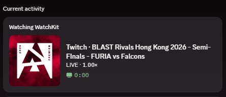
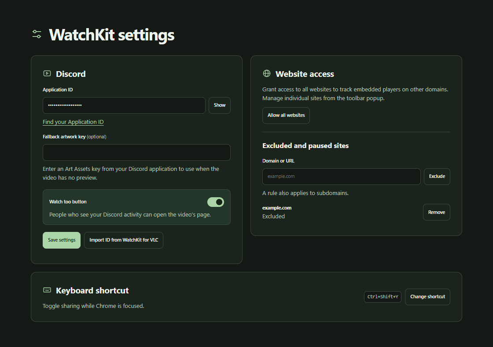

# WatchKit for Chrome

**Show what you're watching in Chrome on your Discord profile.**

[Download for Windows](https://github.com/smilekritik/browser-watchkit/releases/latest) · [Install](#install) · [Discord setup](#get-a-discord-application-id) · [Use WatchKit](#use-watchkit) · [WatchKit for VLC](https://github.com/smilekritik/vlc-watchkit)

WatchKit follows the selected Chrome tab. The Discord card shows the site, video title, preview when available, playback speed, and time left. A configurable keyboard shortcut pauses and resumes tracking across Chrome.

## WatchKit for Chrome and VLC

Use the same Discord application in both editions. Enter the same **Application ID** in Chrome and VLC to publish playback under one name on your Discord profile. You only need to create the application once. [WatchKit for VLC](https://github.com/smilekritik/vlc-watchkit)

## Screenshots

| Bilibili video | Twitch live stream |
| --- | --- |
|  |  |

## Install

You need Windows 10 or 11 x64, Chrome 119 or later, and the [Discord desktop app](https://discord.com/download).

1. Under **Assets** on the release page, download `WatchKit-Chrome-…-win-x64.zip`. The **Source code** archives require a build. [Download page](https://github.com/smilekritik/browser-watchkit/releases/latest)
2. Right-click the ZIP in File Explorer, choose **Extract All**, and open the extracted folder. Keep this folder after installation because Chrome loads the extension from it.
3. Double-click **Install WatchKit.bat** under the Windows account you use for Chrome. It runs the bridge installer using Windows PowerShell. You can run it as a regular user without opening a terminal or installing PowerShell 7. Look for `Browser WatchKit bridge registered for your Windows account.` before closing the window.
4. Paste `chrome://extensions` into Chrome's address bar. Turn on **Developer mode**, click **Load unpacked**, and select the `extension` folder inside the extracted folder. Choose the folder that contains `manifest.json`.
5. Open Chrome's **Extensions** menu and pin **WatchKit**. Continue with the Discord setup below.

The bridge runs when Chrome needs it. If you prefer PowerShell, run `Unblock-File -LiteralPath .\scripts\install.ps1` from the extracted folder, then run `.\scripts\install.ps1`. You can also right-click the unblocked script and choose **Run with PowerShell**. The batch file keeps the setup result visible.

## Get a Discord Application ID

Use the same Application ID for WatchKit in Chrome and VLC. If you already have a Discord application for WatchKit, open it and skip to step 3.

1. Sign in to the [Discord Developer Portal](https://discord.com/developers/applications) and choose **New Application**.
2. Enter `WatchKit` as the name and click **Create**. Discord uses that name in the activity heading.
3. In your application's sidebar, open **General Information**. Find **Application ID** and click **Copy**.

The Application ID is public. You can set up Rich Presence with the ID alone, without creating a bot or copying a token. For optional fallback artwork, upload an image under **Rich Presence → Art Assets** in that application and copy its asset key.

## Connect Discord in Chrome

1. Open the Discord desktop app and sign in.
2. Open the WatchKit popup and click **Set up Discord** or the **Settings** icon. In the settings tab, paste your **Application ID** and click **Save settings**. The field masks the ID. Click **Show** if you want to check it. If WatchKit for VLC already has an ID saved under the same Windows account, click **Import ID from WatchKit for VLC**. [WatchKit for VLC](https://github.com/smilekritik/vlc-watchkit)
3. Open a video tab. In the popup, choose **Allow this site** for a video served by the current site. When the site embeds a player on another domain, open **Settings → Website access → Allow all websites** to give WatchKit access to both the page and the player. Return to the video tab.
4. Turn on **Share on Discord**, play the video, and keep its tab selected. Look for **Sharing on Discord** in the popup and check the card on your Discord profile.

If the card is missing, open Discord's **User Settings → Activity Privacy** and enable activity sharing. Check that WatchKit has the Application ID from **General Information**.

## Use WatchKit

- Switching tabs switches the activity. Selecting a tab without video clears it. Opening Discord or another app leaves the last selected Chrome tab as the source.
- Open the popup on a website to **Pause until restart** or **Exclude site**. Manage both in **Settings → Website access → Excluded and paused sites**. A domain rule also covers its subdomains.
- For local videos, enable **Allow access to file URLs** in the extension's Chrome details and grant access from the popup. The activity title is `Local video`.
- Press **Ctrl+Shift+Y** while Chrome is focused to turn tracking off across the browser and clear the Discord activity. Press it again to resume. The toolbar icon shows **OFF** while tracking is off, and WatchKit remembers the setting after Chrome restarts.
- To change the shortcut or assign one if it is unbound, click **Settings → Change shortcut** or open `chrome://extensions/shortcuts` and find **Toggle WatchKit tracking**.

WatchKit detects accessible HTML video, including players in frames that Chrome allows it to read. Some sites expose limited metadata or use inaccessible players. Chrome internal pages and incognito windows are outside its scope.

### Series and embedded players

| Site and player | What WatchKit reads |
| --- | --- |
| YummyAnime with Kodik | Page title, selected episode and poster from YummyAnime. The card prefers an English title when available. |
| Habster with Alloha | Series title and poster from Habster. Season and episode come from the current Alloha controls. |
| Habster with Collaps | Series title and poster from Habster. Season and episode come from the title that Collaps updates on episode changes. |
| VK Video and RUTUBE | The video title and artwork when the player or page exposes them. Episode numbers depend on the video title or player metadata. |
| Other players | The general HTML-video tracker uses the metadata a player exposes. Tracking time and tracking an episode are separate capabilities. |

## Data and previews

When you share playback, **Watch too** lets people who can see your Discord activity open the video page. To hide the link, turn off **Watch too button** under **Settings → Discord** and click **Save settings**. The button uses the page's HTTPS address and keeps only recognized video parameters, such as YouTube's video ID or the part number on Bilibili. If the player keeps the episode selection inside its frame, viewers can select the episode on the page. Discord only shows the button to other users. [Test Rich Presence buttons](https://docs.discord.com/developers/discord-social-sdk/development-guides/setting-rich-presence#setting-buttons)

The extension saves your Discord application ID, artwork key, sharing preference, and site exclusions in this Chrome profile. It sends activity details to Discord desktop through the local bridge. It keeps no viewing history. Chrome's navigation permission lets the extension follow page changes on the selected tab.

WatchKit looks for public HTTPS artwork in the player's media metadata, the video poster, and preview tags on the page. For supported YouTube and Bilibili previews, Discord receives a wsrv.nl image URL with the original public thumbnail URL as a parameter. wsrv.nl fits the full image into a square with black padding as needed. Other previews use their original URL. WatchKit skips external artwork URLs that contain query strings, which can carry session or access tokens. If it finds no usable URL, it uses your optional fallback artwork key.

## Update or remove

To update, turn sharing off and close Chrome. Extract the new release and copy its files into the original folder, replacing the older files. Double-click **Install WatchKit.bat**, then open Chrome and click **Reload** on the WatchKit card at `chrome://extensions`. Refresh any video tab you had open. Keeping the original extension folder preserves its settings.

To remove it, close Chrome, unblock and run `./scripts/uninstall.ps1` from the release folder, then remove WatchKit in `chrome://extensions`.

## Troubleshooting

| What you see | What to check |
| --- | --- |
| Installer says to download the release ZIP | Check for `build/browser-watchkit-host.exe` next to the `extension` and `scripts` folders. Extract the Windows x64 ZIP from **Assets** before running the installer. |
| PowerShell reports a missing `LiteralPath` or a doubled path | Double-click **Install WatchKit.bat** in the extracted folder. |
| **Native bridge unavailable** | Rerun **Install WatchKit.bat** using the same Windows account as Chrome. Look for the registration message, then reload WatchKit in `chrome://extensions`. If it still fails, note the extension ID and any error from the WatchKit card. The release extension ID is `eohflcpmoebbejkcihlbmnakgoolhmdn`. For a custom build with a different ID, run `.\scripts\install.ps1 -ExtensionId YOUR_EXTENSION_ID`. |
| **Waiting for video** | Play the video in the selected Chrome tab and check its site permissions and exclusions. For a player embedded from another domain, grant **Allow all websites**, then refresh the tab. |
| **Discord rejected the activity** or no Discord card | Check that Discord desktop is open and signed in, that activity sharing is enabled in Discord, and that you saved the **Application ID** from **General Information**. |
| The card shows only a player name or misses the episode | Record the page URL and the selected player's name. A site can offer multiple players and each can expose title, season, and episode data differently. |
| The card shows a question mark or the wrong artwork | Under **Settings → Discord**, clear the fallback artwork field or enter an asset key that exists in the same Discord application, then save. A site can provide a preview URL that Discord cannot load, for example when it requires a signed-in browser. |

## Build from source

Clone this repository or extract the source ZIP. In PowerShell 7, use `Get-ChildItem ./scripts -Filter *.ps1 -File | Unblock-File` if needed, then run `./scripts/build.ps1`. The build downloads and verifies its compiler and JSON header. Run **Install WatchKit.bat** in the checkout, then load its `extension` folder in Chrome. Run `npm test` with Node.js to check activity formatting and selection.

The native Discord transport is shared with [WatchKit for VLC](https://github.com/smilekritik/vlc-watchkit). See [LICENSE](LICENSE).
