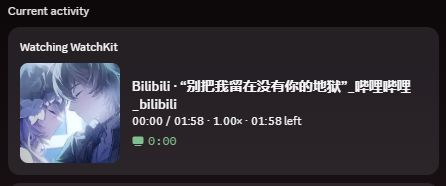
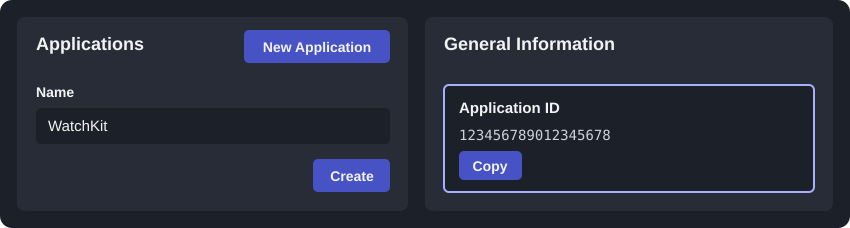

<div align="center">

# WatchKit for Chrome

**Show what you're watching in Chrome on your Discord profile.**

[Download for Windows](https://github.com/smilekritik/browser-watchkit/releases/latest) · [Install](#install) · [Use WatchKit](#use-watchkit) · [WatchKit for VLC](https://github.com/smilekritik/vlc-watchkit)

</div>

WatchKit follows the selected Chrome tab. The Discord card shows the site, video title, preview when available, playback speed, and time left. A configurable keyboard shortcut pauses and resumes tracking across Chrome.

## Screenshots

| Bilibili video | Twitch live stream |
| --- | --- |
|  |  |


## Install

You need Windows 10 or 11 x64, Chrome 119 or later, [PowerShell 7](https://learn.microsoft.com/en-us/powershell/scripting/install/installing-powershell-on-windows), and the [Discord desktop app](https://discord.com/download). The release ZIP includes the Windows bridge and unpacked Chrome extension.

1. Download the Windows x64 ZIP under **Assets** on the [release page](https://github.com/smilekritik/browser-watchkit/releases/latest). Extract it to a folder you can keep.
2. Open PowerShell 7 in the extracted folder under your regular Windows account. Review the installer, then run the commands below.
3. In Chrome, open `chrome://extensions`, turn on **Developer mode**, and click **Load unpacked**. Select the extracted `extension` folder containing `manifest.json`. You can pin **WatchKit** from Chrome's Extensions menu.

```powershell
Unblock-File -LiteralPath ./scripts/install.ps1
./scripts/install.ps1
```

## Get a Discord Application ID

Use the same Application ID for WatchKit in Chrome and VLC. If you already have a Discord application for WatchKit, open it and skip to step 3.

1. Sign in to the [Discord Developer Portal](https://discord.com/developers/applications) and choose **New Application**.
2. Enter `WatchKit` as the name and click **Create**. Discord uses that name in the activity heading.
3. In your application's sidebar, open **General Information**. Find **Application ID** and click **Copy**.



The Application ID is the public numeric identifier. For optional fallback artwork, upload an image under **Rich Presence > Art Assets** in the same application and copy its asset key.

## Connect Discord in Chrome

1. Open and sign in to Discord desktop.
2. Paste the Application ID into the WatchKit popup and click **Save**. If [WatchKit for VLC](https://github.com/smilekritik/vlc-watchkit) already has an ID saved under the same Windows account, **Import saved ID** copies it into Chrome.
3. Open a video tab. In the popup, choose **Allow this site** or **Allow all websites**, then turn sharing on. Play the video and check your Discord profile.


## Use WatchKit

- Switching tabs switches the activity. Selecting a tab without video clears it. Opening Discord or another app leaves the last selected Chrome tab as the source.
- Open the popup on a website to **Pause for this session** or **Exclude permanently**. Manage both under **Site exclusions**. A domain rule also covers its subdomains.
- For local videos, enable **Allow access to file URLs** in the extension's Chrome details and grant access from the popup. The activity title is `Local video`.
- Press **Ctrl+Shift+Y** while Chrome is focused to turn tracking off across the browser and clear the Discord activity. Press it again to resume. The toolbar icon shows **OFF** while tracking is off, and WatchKit remembers the setting after Chrome restarts.
- To change the shortcut or assign one if it is unbound, click **Keyboard shortcut** in the popup or open `chrome://extensions/shortcuts` and find **Toggle WatchKit tracking**.

WatchKit detects accessible HTML video, including players in frames that Chrome allows it to read. Some sites expose limited metadata or use inaccessible players. Chrome internal pages and incognito windows are outside its scope.

## Data and previews

The extension saves your Discord application ID, artwork key, sharing preference, and site exclusions in this Chrome profile. It sends activity details to Discord desktop through the local bridge. It keeps no viewing history. Chrome's navigation permission lets the extension follow page changes on the selected tab.

WatchKit uses available public HTTPS artwork from the video or page. For supported YouTube and Bilibili previews, Discord receives a wsrv.nl image URL with the original public thumbnail URL as a parameter. wsrv.nl fits the full image into a square with black padding as needed. Other previews use their original URL. When a preview is unavailable, WatchKit uses the optional fallback artwork key.

## Update or remove

To update, turn sharing off and close Chrome. Extract the new release over the original folder, rerun the install commands, then open `chrome://extensions` and reload WatchKit. Keeping the same unpacked extension preserves its settings.

To remove it, close Chrome, unblock and run `./scripts/uninstall.ps1` from the release folder, then remove WatchKit in `chrome://extensions`.

If the popup says **Native bridge unavailable**, rerun the installer under the Windows account that runs Chrome and reload the extension. If no card appears, check **Activity Privacy** in Discord and confirm the application ID in the popup.

## Build from source

Clone this repository or extract the source ZIP. In PowerShell 7, use `Get-ChildItem ./scripts -Filter *.ps1 -File | Unblock-File` if needed, then run `./scripts/build.ps1`. The build downloads and verifies its compiler and JSON header. Follow the install steps above using this folder. Run `npm test` with Node.js to check activity formatting and selection.

The native Discord transport is shared with [WatchKit for VLC](https://github.com/smilekritik/vlc-watchkit). See [LICENSE](LICENSE).
