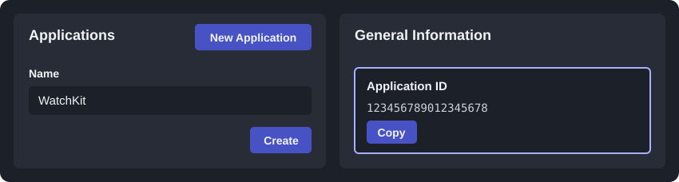

# Use your own Discord application

Use these steps if you want a custom name or artwork on your Discord activity. For the shared WatchKit application, follow [Connect Discord in Chrome](../README.md#connect-discord-in-chrome).

1. Open the [Discord Developer Portal](https://discord.com/developers/applications) and select **New Application**.
2. Give the application the name you want Discord to show and select **Create**.
3. Open **General Information** and copy the **Application ID**. It's public and is the only identifier WatchKit needs for Rich Presence.
4. Open WatchKit's **Settings → Discord**, paste the ID into **Application ID**, and click **Save settings**. If you also use WatchKit for VLC, enter the same ID in **View → WatchKit Settings** there.
5. Keep Discord desktop open and play media on a site you've allowed in WatchKit. Check that **Share on Discord** is on and look for the activity in your full Discord profile.

To return to the shared WatchKit application in Chrome, clear **Application ID** and click **Save settings**.

For fallback artwork, upload an image in **Rich Presence → Art Assets**. Enter its asset key in WatchKit's **Fallback artwork key** and save. Rich Presence works with the public Application ID without creating or hosting a bot. [Discord Rich Presence without authentication](https://docs.discord.com/developers/discord-social-sdk/development-guides/setting-rich-presence#rich-presence-without-authentication)
